# dash: interactive HTML dashboards from twoway syntax

`dash` converts Stata `twoway` plot syntax into interactive dashboards
powered by the Bokeh visualization library: forty-four twoway plot types,
multi-graph layouts, linked brushing, filter widgets
(dropdown/multi/slider/range) and KPI cards. Options are written as for
twoway: what twoway refuses is refused, the options dash draws are drawn,
and the few it does not draw are named in a note -- see `help dash`,
Differences from twoway and Unsupported Stata twoway options; dash adds
two options of its own, hover() and table (see `help dash`, dash's own
options).

A saved dashboard is one self-contained HTML file, with BokehJS embedded,
that opens offline, without a server or an internet connection; it is
tested in Google Chrome.
`dash serve` runs the dashboard on a Bokeh Server instead, and `dash build`
with the `server` option writes such an app for you to launch.

`dash` takes the place of `twoway` (on Stata 19 and later): write
`dash scatter mpg weight` where you would write `twoway scatter mpg weight`.
A dashboard is an HTML page, not a Stata graph: see `help dash`, Stata graph integration.
It has been tested on macOS arm64 with StataNow 19.5, run from the console.

Beyond the graphs, a dashboard can carry:

- several graphs and KPI cards in a `layout()` grid or in `tabs()`;
- filter widgets that every graph and card follows, and link groups whose
  graphs share a box or lasso selection (`link()`, `brush(filter)`);
- KPI cards of a statistic, weighted as `summarize` weights it;
- a folded data table of the rows a graph draws (the `table` graph option)
  and, with `csv`, a Download CSV button;
- PNG and SVG export from the toolbar;
- names for screen readers on every graph, filter, table and card, and
  keyboard-operable tabs.

## Requirements

- Stata 19 or later; tested on StataNow 19.5 (MP), macOS arm64.
  Measured on MP only; Stata 19.0, Stata/BE and Stata/SE have not been run.
  It is run from the console; Windows, Linux, Intel macOS and Stata's graphical interface have not been run.
- Python 3.11+, bokeh>=3.8,<3.10, numpy>=2.3, pandas>=2.3.

## Installation

```stata
net install dash, from("https://wbuchanan.github.io/dash")
dash_setup
```

## dash_setup

Run `dash_setup` once after installation: it checks the dependencies and
installs the missing Python packages; where the Python refuses pip installs
(PEP 668), `dash_setup, venv(path)` sets up a private environment instead.
See `help dash_setup`.

## Example

```stata
sysuse auto, clear
dash (scatter mpg weight) (lfit mpg weight), title("MPG vs Weight") saving(fit.html)
```

## Gallery

<!-- dash-gallery:start -->
These pairs were drawn on 14nov2026 at dash commit 0a6498a; each verdict is the corpus comparison's (make corpus).

<p>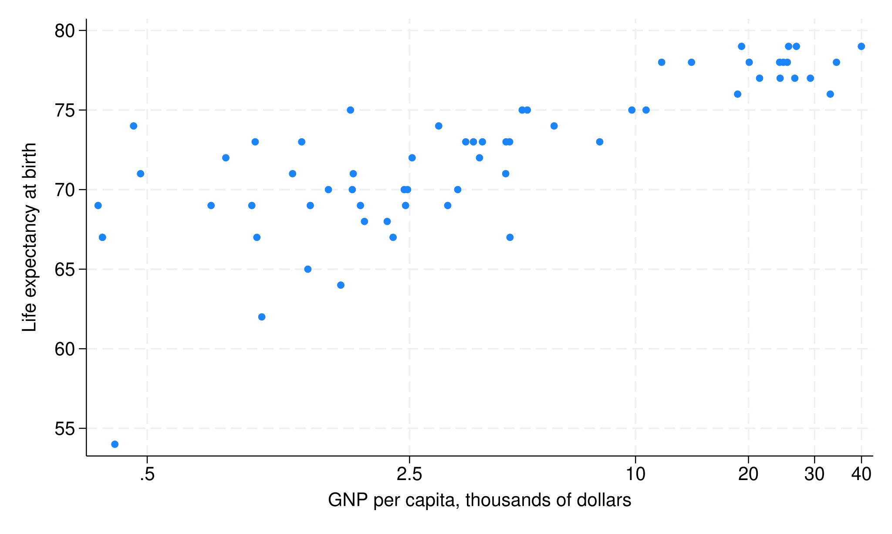 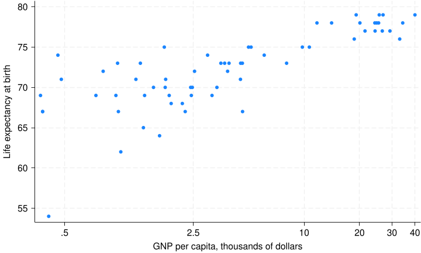<br><code>twoway scatter lexp gnp000, xsca(log) xlabel(.5 2.5 10(10)40)</code><br><b>Close</b>: margins</p>
<p>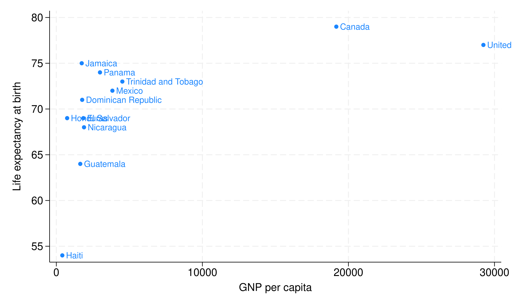 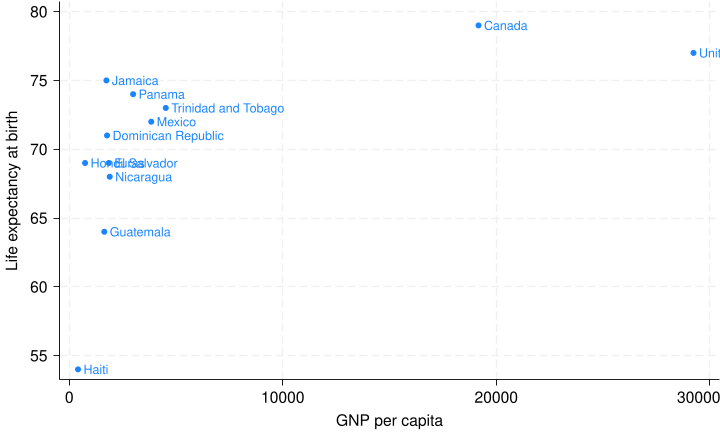<br><code>twoway scatter lexp gnppc if region==2, mlabel(country)</code><br><b>Close</b>: margins</p>
<p>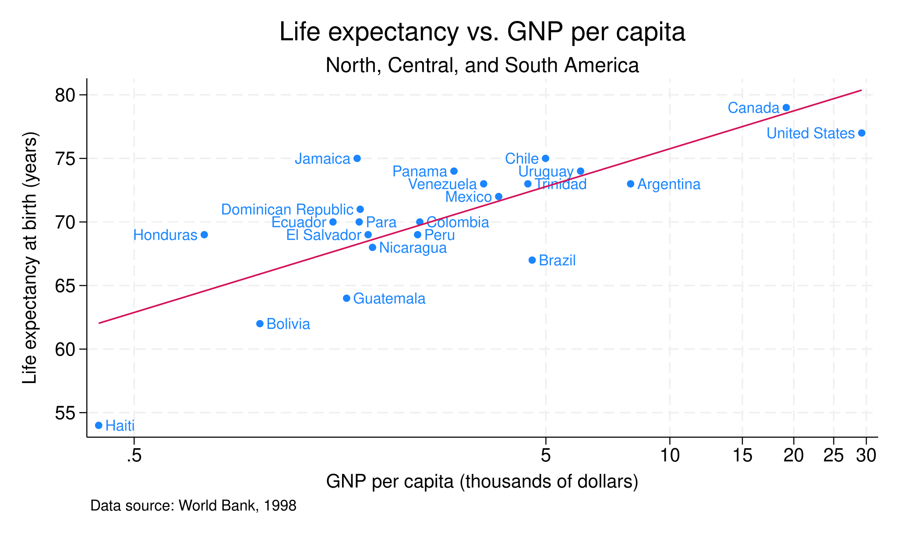 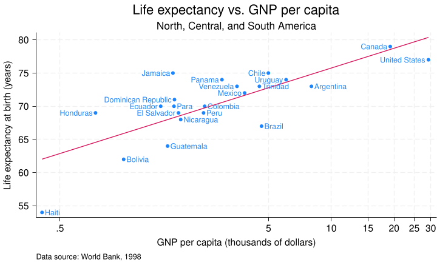<br><code>twoway (scatter lexp gnppc, mlabel(country) mlabv(pos)) (line hat gnppc, sort) , xscale(log) xlabel(.5 5 10 15 20 25 30) legend(off) title(&quot;Life expectancy vs. GNP per capita&quot;) subtitle(&quot;North, Central, and South America&quot;) note(&quot;Data source: World Bank, 1998&quot;) ytitle(&quot;Life expectancy at birth (years)&quot;)</code><br><b>Close</b>: margins</p>
<p> <br><code>twoway line le year || fpfit le year || , ytitle(&quot;Life expectancy, years&quot;) xlabel(1900 1918 1940(20)2000) title(&quot;Life expectancy at birth&quot;) subtitle(&quot;US, 1900 to 1999&quot;) note(&quot;Source: National Vital Statistics Report, Vol. 50 No. 6&quot;) legend(off) text(48.5 1923 &quot;The 1918 influenza pandemic was the worst epidemic&quot; &quot;known in the US&quot; &quot;More citizens died than in all combat deaths of the&quot; &quot;20th century.&quot; , place(se) box bcolor(gs15) just(left) margin(l+4 t+1 b+1) width(85))</code><br><b>Close</b>: margins</p>
<p>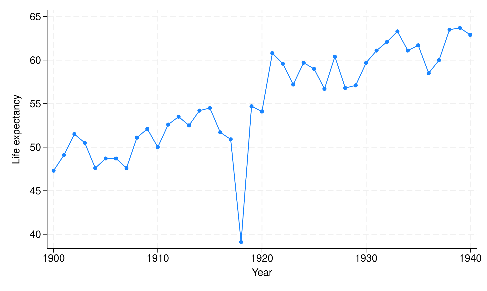 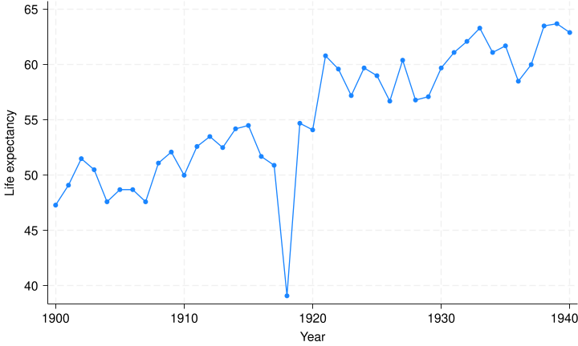<br><code>twoway connected le year</code><br><b>Close</b>: margins</p>
<p>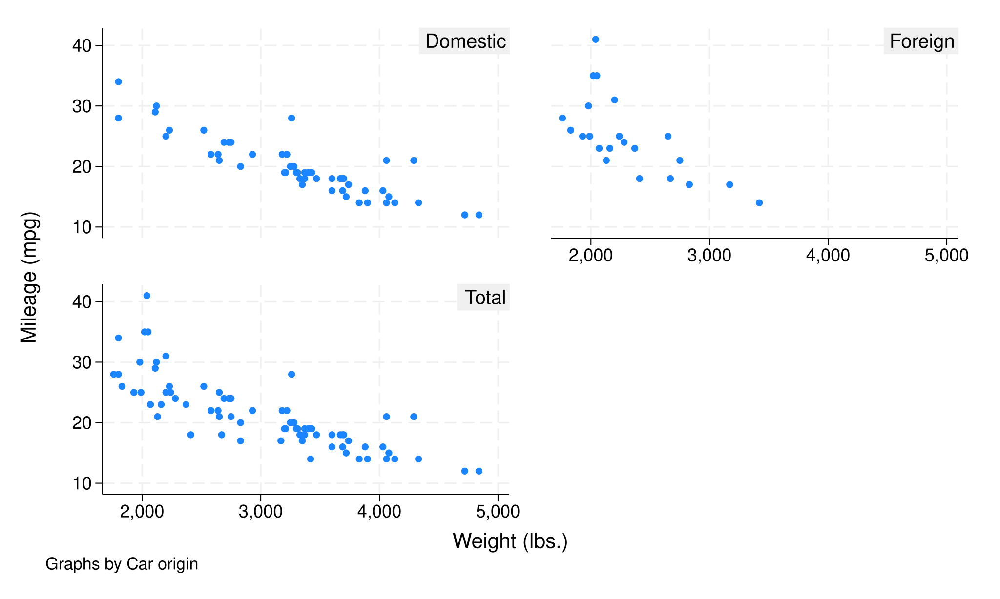 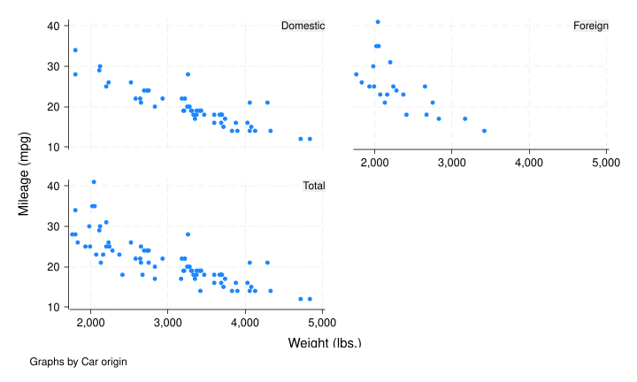<br><code>twoway scatter mpg weight, subtitle(, ring(0) pos(1) nobexpand) by(foreign, total)</code><br><b>Close</b>: margins</p>
<p>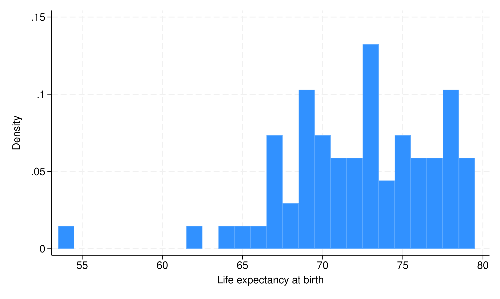 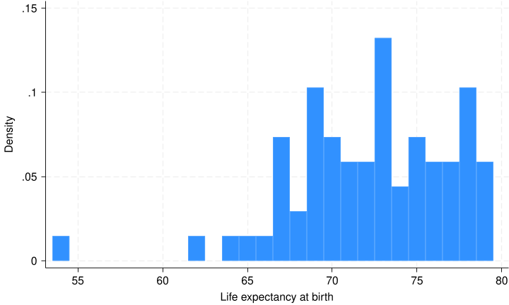<br><code>twoway histogram le, discrete</code><br><b>Close</b>: margins</p>
<p>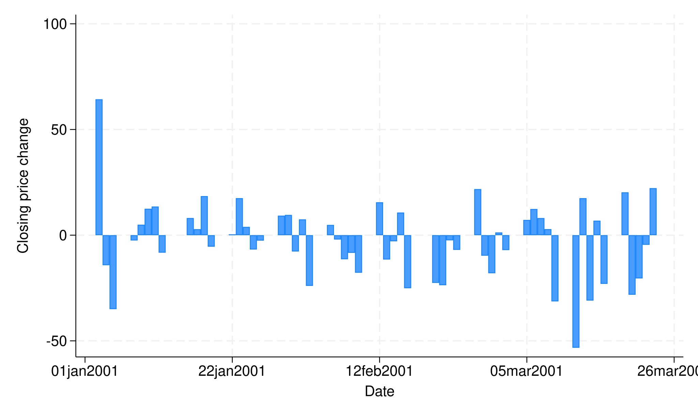 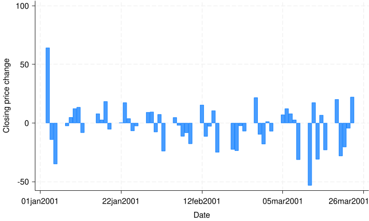<br><code>twoway bar change date in 1/57</code><br><b>Close</b>: margins</p>
<p>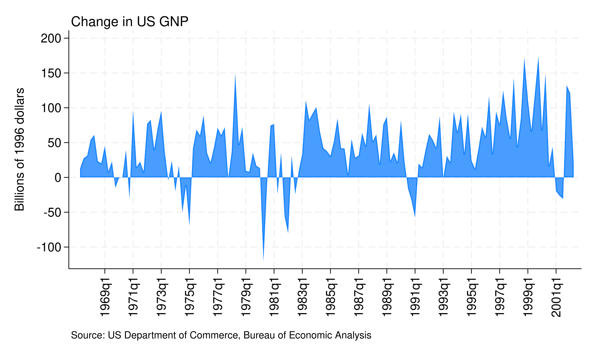 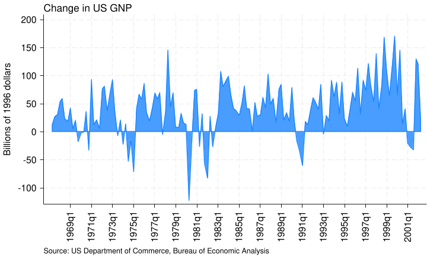<br><code>twoway area d.gnp96 date, xlabel(36(8)164, angle(90)) ylabel(-100(50)200) ytitle(&quot;Billions of 1996 dollars&quot;) xtitle(&quot;&quot;) subtitle(&quot;Change in US GNP&quot;, position(11)) note(&quot;Source: US Department of Commerce, Bureau of Economic Analysis&quot;)</code><br><b>Close</b>: margins, line width, plot region shape</p>
<p>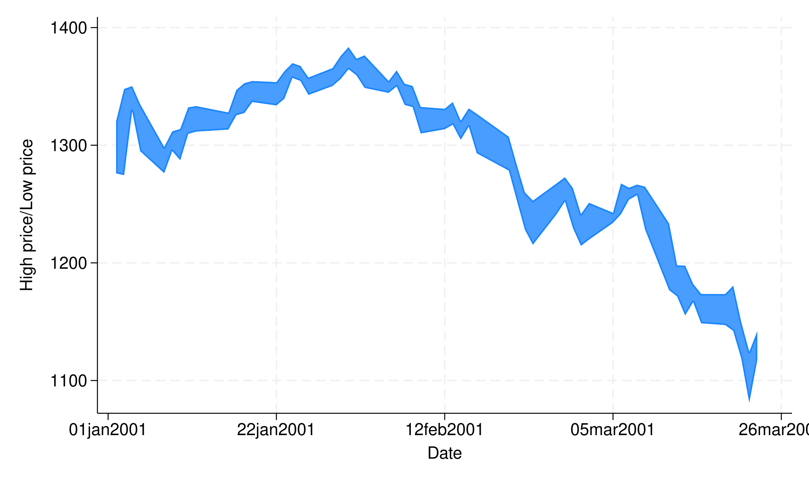 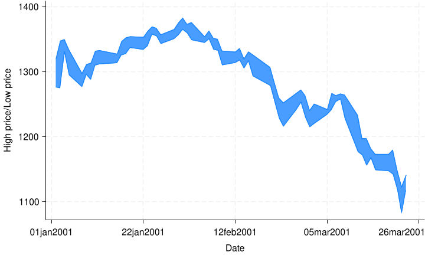<br><code>twoway rarea high low date in 1/57</code><br><b>Close</b>: margins, line width</p>
<p>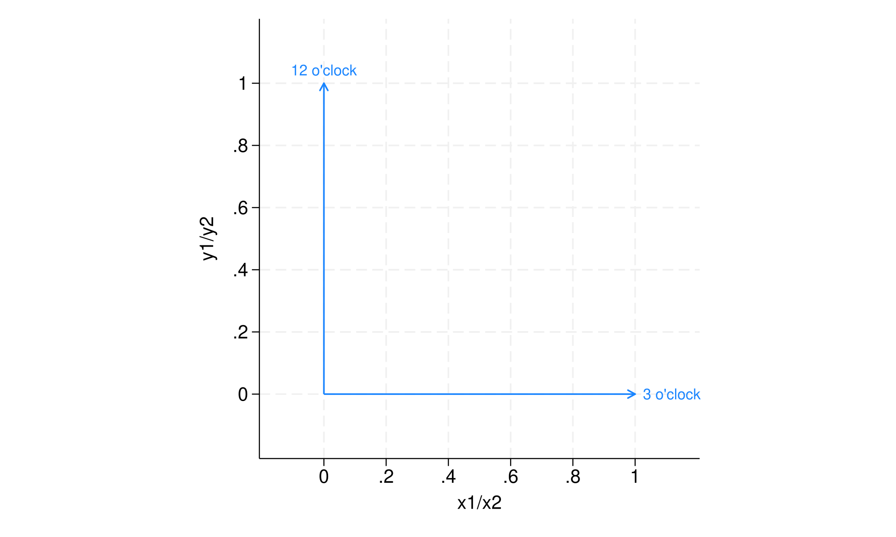 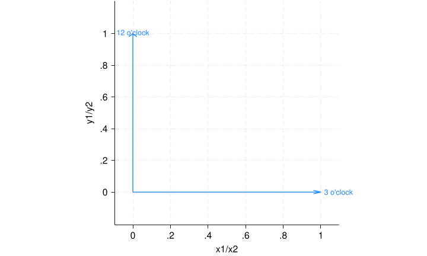<br><code>twoway pcarrow y1 x1 y2 x2 , aspect(1) mlabel(time) mlabvposition(pos) headlabel plotregion(margin(vlarge))</code><br><b>Close</b>: margins</p>

Every example twoway draws, with its live dash graph, is on the gallery pages: [https://wbuchanan.github.io/dash/gallery/](https://wbuchanan.github.io/dash/gallery/).
<!-- dash-gallery:end -->

## Documentation

- [The user's guide](https://wbuchanan.github.io/dash/guide/) -- how to use
  KPI cards, filters, data tables, linked brushing, tabs and the other
  dashboard features, each with a live example.
- `help dash` -- the syntax, the differences from `twoway`, and the
  dashboard options.
- `help dash_setup` -- installing and checking the Python dependencies.
- [CHANGELOG.md](CHANGELOG.md) -- what changed in each release.

## Support

To report a problem or ask for a feature, file an issue at
<https://github.com/wbuchanan/dash> (the Issues tab), saying which versions
of dash and Stata you run and giving the command that shows the problem.
The maintainer, Billy Buchanan, can be reached at
<william@williambuchanan.net>.
